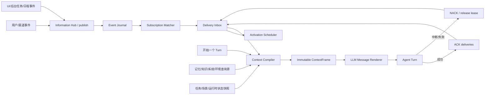

# 白龙马统一信息订阅重构方案

> 工作分支：`refactor/unified-information-subscriptions`
>
> 分析基线：`ac8c37b` 及当前工作区代码
>
> 本阶段范围：只建设“信息如何到达 Agent、如何组成上下文”的机制；事务管理另立领域模型，不在本阶段实现。

## 1. 结论

这次重构不应继续把所有能力塞进现有的 `information-subscription-engine`。现有实现适合作为一个 Provider 适配器继续使用，但它只解决了“某个轮次是否拉取一个快照”，没有统一用户消息、记忆、系统环境、任务动态、日程事件和 UI 事件。

推荐建立四个核心概念：

1. **InformationItem（信息项）**：Agent 能看到的统一信息单位，保留来源、作者、时间、可信度、敏感度、时效和关联关系。
2. **InformationSubscription（信息订阅）**：声明“谁在什么条件下接收哪些信息”，分别配置匹配、采样、唤醒、投递、上下文预算和确认策略。
3. **InformationDelivery（信息投递）**：一次具体、可租约、可确认、可重试的投递，解决中断、重启、重复消费和多 Agent 消费问题。
4. **ContextFrame（上下文帧）**：一个 Agent turn 最终收到的不可变信息包，由触发信息、订阅信息、查询结果和状态快照组成，再按语义渲染给模型。

统一的是协议、路由、生命周期和观测，不是把所有信息强制写进同一张表或同一个 prompt section：

- 用户消息仍然是用户写的消息，必须保留 `user-authored` 语义。
- 记忆仍然通过相关性检索，不应被伪装成刚发生的事件。
- 系统时间和设备状态通常是即时快照，不必永久保存完整内容。
- 日程到期、后台任务完成和 UI 操作是事件，可以唤醒或延迟到下一轮。
- 任务状态在本阶段只是信息源；“这件事是否完成、谁负责、承诺是什么”属于后续事务管理。

## 2. 现有代码链路

| 信息类型 | 当前入口/来源 | 当前唤醒方式 | 当前注入方式 | 主要问题 |
| --- | --- | --- | --- | --- |
| 用户消息 | `api/routes/message.js`、社交连接器、TUI → `inbound-message.js` | 写入 `conversations` 后进入内存 `queue.js` | `runTurn` + `buildLLMMessages`，最终作为 `role=user` | 持久化、排队、唤醒、当前轮语义耦合；队列本身不耐重启；同用户待处理消息会被合并 |
| 记忆/画像/对话 | `runMemoryInjector` | 不唤醒，随 turn 查询 | 多路检索后渲染到 `<memories>`、`<person>` 等 | 不在订阅模型内；检索、选择、字符串格式化较早耦合 |
| 知识库 | `runKnowledgeInjector` | 不唤醒，随 turn 查询 | 独立 `<knowledge-evidence>` | 有来源与审计，是可复用的良好边界，但不参与统一预算和去重 |
| 系统/环境 | `buildSystemEnv`、`runInformationInjector`、runtime injector、context rules、capability prefeed | 不唤醒 | 分散进入 `<runtime>`、`<extra>` 等 | 同一个来源有多套匹配入口；`installed_software` 已出现 Provider、规则和 `buildSystemEnv` 三条路径 |
| 任务动态 | `state.task`、`taskSteps`、`recentActions`、thread state | 活跃任务会把心跳加速到 30 秒 | `index.js` 手工拼入 context 和 runtime messages | 状态、调度、上下文和未来事务语义混在主循环中 |
| 日程/提醒 | reminders repository → `enqueueDueReminders` | 到期后构造 `SYSTEM/REMINDER` 伪消息进入 background queue | L3 system wrapper | 调度事件被降格成消息；重试和投递依赖专用字段；无法复用通用投递语义 |
| UI 事件 | scene handler → `ui_signals` | 主动 UI intent 又会 `pushMessage`，被动事件不唤醒 | 过去一分钟汇总后注入 | 同一事件存在“写信号表”和“造消息”两条路径；`consumed` 是全局布尔值，不能支持多个订阅者 |
| 后台任务动态 | 例如 browser download events | 重要事件构造 `APP_SIGNAL` 伪消息 | 当前轮又读取 download snapshot | 事件和快照并行但没有统一去重、因果链和投递确认 |

当前 turn 的实际结构是：

1. `consciousness-loop` 从用户/后台两条内存队列中取一个 entry，或者生成 L2 TICK。
2. `runTurn` 根据 `msg/null` 和 `runtimeLane` 推断 L1/L2/L3。
3. `runInjector` 分别运行 tool、memory、information injector。
4. `index.js` 继续追加知识、系统环境、任务、场景、能力 prefeed、规则上下文等信息。
5. `buildContextBlock` 和 `buildLLMMessages` 把这些结果转换成模型消息。
6. 模型调用成功后，UI signal 和 scheduled provider subscription 才被确认消费。

这里已经有一些应该保留的好基础：

- injector 已拆分为 memory/tool/information 三个职责面。
- Provider registry 已有 `timeoutMs`、`maxChars`、`sensitivity` 和 on-demand matcher。
- UI signal 和 scheduled subscription 已采用“先读、成功后确认”的两阶段消费。
- L1/L2/L3 已有明确的输出与投递边界。
- Knowledge Cortex 已把来源证据和自传式记忆分开。
- 队列已有优先级和抢占概念。

## 3. 现有订阅引擎的边界

`information-subscription-engine.js` 当前语义是：在每个 turn 开始时，根据 Provider 默认模式和持久订阅记录，决定是否执行 `collect(context)`。

它存在这些结构性限制：

1. **只支持 pull snapshot**：没有事件发布、topic、游标或 inbox，无法承载用户消息和 UI/后台事件。
2. **`mode` 混合了不同维度**：`default/on_demand/scheduled` 同时表达匹配与采样，但没有独立的 wake policy 和 delivery policy。
3. **scheduled 不会唤醒 Agent**：它只是“间隔到期后的下一轮才注入”，不是真正的日程或监控。
4. **一位订阅者对一个 Provider 只能有一条订阅**：唯一键阻止对同一来源建立多个过滤条件或用途不同的订阅。
5. **消费状态挂在订阅上**：`last_delivered_at` 不能表示某一条信息对多个订阅者的独立投递状态。
6. **`instruction` 混入事务语义**：例如“电量低时提醒我”不只是路由偏好，而是持续义务。订阅负责让电量信息到达 Agent；义务本身最终应由事务管理持有。
7. **敏感度目前只展示、不执行**：`sensitivity` 没有实际参与权限、目标范围、日志脱敏和 prompt 策略。

因此，现有引擎应作为 `snapshot-provider` 兼容层迁移，而不是成为新的总线内核。

## 4. 目标架构



Information Hub 由两个数据面组成：

- **Push/Event 面**：用户消息、UI intent、日程到期、后台任务变化等先发布事件，再匹配订阅并生成投递。
- **Pull/Projection 面**：记忆相关性、知识证据、系统时间、设备快照、任务当前状态等在 Context Compiler 构帧时查询。

两者最终都产出 `InformationItem`，因此可以统一排序、去重、预算、权限、来源追踪和渲染；但只有 push 事件需要 journal 和 delivery inbox。

## 5. 核心领域模型

### 5.1 InformationItem

建议的逻辑结构如下。第一期可以用 JSDoc + runtime validator，不要求立刻引入 TypeScript。

```js
{
  id: 'info_...',
  topic: 'conversation.user_message',
  schemaVersion: 1,
  source: { id: 'channel:tui', kind: 'event' }, // event | snapshot | query
  subject: { userId, agentId, sessionId, taskId },
  authorship: 'user',                            // user | agent | system | external
  semanticKind: 'user_input',                   // 见下文语义通道
  payload: {},
  payloadRef: { table: 'conversations', id: 123 },
  occurredAt: '...',
  observedAt: '...',
  expiresAt: null,
  priority: 100,
  sensitivity: 'normal',
  trust: 'authoritative',
  orderingKey: 'conversation:ID:000001',
  dedupeKey: 'client-message-id',
  correlationId: 'turn-or-workflow-id',
  causationId: null,
  traceId: '...',
  metadata: {}
}
```

必须保留 `authorship` 和 `semanticKind`。当前代码有多处把“不是用户写的运行时信息”放进 `role=user`，再靠文字声明“not user-authored”。新编译器必须从结构上阻止这类角色混淆。

建议的语义通道：

| semanticKind | 典型来源 | 渲染原则 |
| --- | --- | --- |
| `user_input` | 用户文字、语音转写、用户上传资源的当前指令 | 只有它可以成为干净的模型 `role=user` 当前消息 |
| `system_fact` | 时间、设备、环境、presence | system/runtime context，注明采样时间和时效 |
| `memory` | 对话记忆、人物、画像、自我历史 | memory section，不宣称为新事实 |
| `knowledge` | Knowledge Cortex | 保留 citation、版本和来源权威性 |
| `policy` | 安全边界、行为约束、激活策略 | 高优先级 system context，不与普通事实混排 |
| `task_state` | 当前任务、步骤、thread/commitment 状态 | 当前状态快照；本阶段不定义义务生命周期 |
| `ui_signal` | 点击、停留、关闭、错误 | 明确为 UI 观察，不自动推断用户意图 |
| `runtime_event` | 提醒到期、后台任务完成、下载失败 | 带事件时间、状态和因果链 |

### 5.2 InformationSource

统一注册表应支持三种来源：

```js
registerInformationSource({
  id: 'memory.relevant',
  kind: 'query', // event | snapshot | query
  topics: ['memory.relevant'],
  sensitivity: 'private',
  timeoutMs: 500,
  maxChars: 12000,
  match(frameRequest) {},
  collect(frameRequest, subscription) {},
  normalize(raw) {},
})
```

- `event`：由生产方调用 `publish()`；例如 user message、UI、schedule due。
- `snapshot`：读取当前状态；例如 system time、task state、scene manifest。
- `query`：根据当前焦点检索；例如 relevant memory、knowledge evidence。

现有 `information-providers.js` 可以被适配成 `snapshot` source；memory、knowledge、context rules 和 capability prefeed 暂时通过 adapter 接入，不需要第一天重写内部算法。

### 5.3 InformationSubscription

不要再用单一 `mode` 表达所有策略。建议拆开：

```js
{
  id: 'sub_...',
  subscriber: { type: 'agent', id: 'agent:primary' },
  topicPattern: 'ui.intent.*',
  scope: { userId: 'ID:000001' },
  filter: { op: 'in', path: 'payload.name', values: ['select', 'submit'] },

  activation: { type: 'event' },                 // event | turn_start | interval | manual
  sampling: { strategy: 'all' },                 // all | latest | window | query | delta
  wake: { policy: 'if_idle', priority: 60 },      // always | if_idle | never
  delivery: { policy: 'next_turn', ack: 'after_model_accept' },
  context: { semanticKind: 'ui_signal', maxChars: 2000, rank: 40 },

  enabled: true,
  createdBy: { type: 'user', id: 'ID:000001' },
  reason: '让 Agent 感知重要 UI 操作'
}
```

关键分离：

- `activation`：何时考虑这条订阅。
- `sampling`：从来源取全部、最新、窗口、查询结果还是变化量。
- `wake`：是否因此新开 turn。
- `delivery`：立即投递、下一轮附带、聚合，以及何时 ACK。
- `context`：进入哪个语义通道、预算和排序。

“每 15 分钟采集设备状态但只有状态有意义变化才唤醒”可以准确表达为 interval activation + delta sampling + conditional wake，而不是把它压进 `scheduled` 一个枚举值。

### 5.4 InformationDelivery

事件与消费状态必须分开。一条事件可以被多个 Agent 或多个订阅分别消费。

推荐生命周期：

```text
pending -> leased -> acked
             |
             +-> pending (中断、超时、显式 NACK)
             +-> dead_letter (超过重试上限)
```

一次 turn 开始时租约一组 deliveries；ContextFrame 记录对应 ack token。模型请求已被接受且该帧真正进入本轮后再 ACK。若被高优先级用户消息中断，则释放租约，下一轮可以重新投递。

### 5.5 ContextFrame

ContextFrame 是编排结果，不是字符串：

```js
{
  turnId,
  lane: 'interactive', // interactive | autonomous | scheduled | background
  triggerItems: [],
  contextItems: [],
  currentUserInput: null,
  deliveryLeaseIds: [],
  sourceAudit: [],
  selectionAudit: [],
  budget: { maxChars, selectedChars, droppedChars },
  createdAt
}
```

Renderer 才负责把它变成 provider 所需的 messages。这样 section gate、字符预算、去重和 prompt trace 都针对结构化 item 工作，不再针对已经拼好的大字符串猜测来源。

## 6. 持久化模型

现有 `information_subscriptions` 保留为 legacy 表，先通过适配器读取；不要直接在原表上硬加大量字段，因为它的唯一键和 CHECK 约束已经不适合新模型。

建议新增三张 canonical 表：

### `information_events`

- `id`、`topic`、`schema_version`
- `source_id`、`source_kind`、`authorship`、`semantic_kind`
- `subject_json`、`payload_json`、`payload_ref_json`、`metadata_json`
- `occurred_at`、`observed_at`、`expires_at`
- `priority`、`sensitivity`、`trust`
- `ordering_key`、`dedupe_key`
- `correlation_id`、`causation_id`、`trace_id`
- 唯一索引：`(source_id, dedupe_key)`，`dedupe_key` 为空时不参与去重
- 查询索引：`topic/occurred_at`、`ordering_key/occurred_at`、`expires_at`

### `information_routes`

领域层仍称 InformationSubscription；数据库用 `routes` 避免与 legacy 表冲突。

- `id`、`subscriber_type`、`subscriber_id`
- `topic_pattern`、`scope_json`、`filter_json`
- `activation_json`、`sampling_json`、`wake_json`、`delivery_json`、`context_json`
- `reason`、`created_by_json`、`enabled`
- `created_at`、`updated_at`

不设置 `(provider, subscriber)` 唯一键，同一来源允许多条用途不同的订阅。

### `information_deliveries`

- `id`、`event_id`、`route_id`、`subscriber_id`
- `state`、`priority`、`available_at`
- `lease_id`、`lease_expires_at`
- `attempts`、`last_error`
- `created_at`、`acked_at`
- 唯一索引：`(event_id, route_id, subscriber_id)`

高频、无长期价值的 UI dwell 等事件可以设置短 TTL；系统时间等 snapshot 默认不进 `information_events`，只在 turn trace 中记录来源和摘要哈希。

## 7. 各类信息的目标映射

| 现有来源 | 新 topic/source | source kind | 默认 wake | 默认 sampling/delivery |
| --- | --- | --- | --- | --- |
| 用户文字/语音 | `conversation.user_message` | event | `always`, priority 100 | 每条精确一次进入 interactive turn；不把“后到消息覆盖前一条”作为信息层默认行为 |
| 用户资源 | `conversation.user_resource` | event | `never` | 按 conversation/user scope 累积，随下一条 user message 绑定 |
| 相关记忆 | `memory.relevant` | query | `never` | 每轮按 current focus 查询、相关性选择 |
| 人物/画像 | `memory.participant_context` | query/snapshot | `never` | 仅对当前参与者和允许的 autonomous scope 查询 |
| 知识证据 | `knowledge.relevant` | query | `never` | 保留 citation，受总预算和独立知识预算双重控制 |
| 系统时间 | `runtime.clock` | snapshot | `never` | turn_start 最新值 |
| 系统/设备/软件 | `runtime.system.*`、`device.*` | snapshot | `never` | on-demand、interval 或 delta；复用现有 scanners |
| 当前任务/步骤 | `task.current_state` | snapshot | `never` | turn_start 最新值 |
| 任务变化 | `task.state_changed` | event | 第一阶段 `never` | 下一轮附带；是否推动事情由未来事务管理决定 |
| reminder 到期 | `schedule.due` | event | `always`, scheduled priority | durable、可重试、明确目标与 delivery policy |
| 主动 UI 操作 | `ui.intent.*` | event | 按 action 配置 `always/if_idle` | 结构化 payload，不再造 `[UI intent ...]` 文本消息 |
| 被动 UI 行为 | `ui.observation.*` | event | `never` | 60 秒窗口聚合或 latest，短 TTL |
| 后台任务变化 | `job.state_changed` | event | 仅重要变化 `if_idle/always` | delta + 当前 job snapshot；按 job id 去重 |
| L2 心跳 | `runtime.heartbeat_due` | event | scheduler 自身触发 | 不再依赖 `TICK ...` 字符串判断语义 |

## 8. 推荐模块边界

```text
src/information/
  envelope.js                 # InformationItem 构造、校验、版本升级
  source-registry.js          # event/snapshot/query source 注册
  hub.js                      # publish/query 的统一门面
  subscription-matcher.js     # topic/scope/filter 匹配
  context-compiler.js         # 构建 ContextFrame，预算/排序/去重
  context-renderer.js         # ContextFrame -> LLM messages/context sections
  delivery-service.js         # lease/ack/nack/retry
  activation-scheduler.js     # pending deliveries -> turn trigger/preemption
  repositories/
    events.js
    routes.js
    deliveries.js
  adapters/
    legacy-provider.js
    inbound-message.js
    memory.js
    knowledge.js
    runtime.js
    task-state.js
    ui.js
    reminders.js
    background-jobs.js
```

第一阶段保留这些门面：

- `runInjector()`：内部逐步改为请求 Context Compiler，外部调用点暂时不变。
- `pushMessage()`：改为 legacy bridge，最终由 `hub.publish()` 取代。
- `buildContextBlock()` / `buildLLMMessages()`：先作为 renderer backend，等 ContextFrame 稳定后再收敛签名。
- 现有 provider registry、memory retrieval、knowledge injector：先包装，不重写算法。

## 9. 四条关键流程

### 9.1 用户消息

1. 渠道适配器规范化身份、附件和 client message id。
2. `hub.publish(conversation.user_message)`；event 与 conversation row 通过 `payloadRef` 关联。
3. 默认订阅生成 primary Agent delivery，wake=always、priority=100。
4. scheduler 租约 delivery 并启动 interactive turn。
5. Context Compiler 把该 item 设为唯一 current user input，同时查询本轮需要的记忆、知识和状态。
6. 模型接受该帧后 ACK；若被更新的高优先级输入中断，释放租约。

### 9.2 记忆注入

1. Context Compiler 根据 current user input、当前任务和 thread focus 构造 query request。
2. `memory.relevant` adapter 调用现有 memory retrieval。
3. 每条结果规范化为 `semanticKind=memory`，保留 memory id、时间、salience 和召回理由。
4. 统一选择器做预算和去重，renderer 最后生成 `<memories>` 等 section。

记忆不是“刚发生的事件”，不会因为被召回就写入 event journal 或唤醒 Agent。

### 9.3 UI 事件

1. Scene/UI 只发布一次结构化事件。
2. `ui.intent.select` 等主动事件匹配可唤醒订阅；mounted/dwell 等只进入窗口订阅。
3. 同一事件对 primary Agent 形成独立 delivery，不再使用全局 `consumed=1`。
4. renderer 明确标为 UI observation，禁止冒充用户口述。

### 9.4 日程到期

1. scheduler materialize 一个 durable `schedule.due` event。
2. route 产生目标 Agent delivery，wake=always。
3. scheduled turn 的 output contract 来自 delivery metadata，而不是一组散落在 queue entry 上的 `reminder*` 字段。
4. 完成投递后 ACK；失败/中断 NACK 并按通用 retry policy 重试。

## 10. 渐进迁移计划

### Phase 0：契约和观测基线

- 完成本方案文档。
- 给现有 L1/L2/L3、UI 两阶段消费、provider scheduled 语义建立 characterization tests。
- 在 turn trace 中记录当前上下文各来源的字符数、耗时和消费 id，形成迁移前基线。

### Phase 1：Information Core，shadow 模式

- shadow publisher 由 `BAILONGMA_INFORMATION_SHADOW=1` 显式开启，默认关闭；开启后也只写入新事件、路由和投递表，不驱动 turn 或 prompt。
- 新增 envelope、source registry、events/routes/deliveries repositories、matcher 和 delivery lifecycle。
- 新增 schema migration，不改变现有 prompt 和 scheduler 行为。
- inbound message、UI、reminder、background job 在执行旧路径的同时 shadow publish；shadow delivery 不驱动 turn。
- 校验 event 数量、去重键、优先级和旧路径结果一致性。

### Phase 2：统一事件输入和唤醒

- scheduler 改为从 delivery inbox 选择 turn trigger；保留 legacy queue bridge 作为回滚开关。
- 先迁 UI 和 background job，再迁 reminder，最后迁 user message。
- 移除 UI intent 的“双写 signal + 伪消息”行为。
- L1/L2/L3 改为由 trigger item 的语义决定，不再依赖 `msg/null` 和字符串 `TICK` 推断。

### Phase 3：ContextFrame 编译器

- 给 memory、knowledge、runtime、task state、scene、prefetch、constraints、capability prefeed 增加 source adapter。
- injector 暂时仍返回兼容字段，但内部以 `InformationItem[]` 为真值。
- 把去重、优先级、字符预算、超时、敏感度和 provenance 集中到 Context Compiler。
- renderer 保证只有 `user_input` 进入当前 `role=user`；其余信息按语义 section 渲染。

### Phase 4：订阅 v2 和 legacy 迁移

- `manage_information_subscription` 改用 routes API，工具参数从单一 mode 迁到 activation/sampling/wake/delivery。
- 自动把 legacy provider subscription 映射为 route；双读一段版本周期。
- Provider registry 接到 source registry，删除 `excludedInformationProviders` 这类局部去重补丁。
- `instruction` 暂时只作为 attention note 兼容；未来由 `matter_id` 代替持续义务。

### Phase 5：清理和强化

- 删除 legacy in-memory queue、`ui_signals.consumed`、旧 subscription engine 和伪消息 wrappers。
- 增加 dead-letter 诊断、事件 TTL 清理、敏感信息审计和按 source/route 的开关。
- 管理 UI 展示“为什么 Agent 被唤醒、看到了哪些信息、哪些信息因预算被丢弃”。

## 11. 推荐的第一个实现切片

第一刀应足够小，且不改变用户可见行为：

1. 新增 `src/information/envelope.js`，定义构造、校验和 topic 命名规则。
2. 新增 `information_events`、`information_routes`、`information_deliveries` repositories。
3. 实现 `publishInformationEvent`、matcher、delivery lease/ack/nack 的纯服务层。
4. 为 user message、UI intent、reminder due、browser download important event 增加 shadow publisher。
5. 增加对照测试，证明 shadow event 与旧 queue entry 在 author、target、priority、dedupe、wake intent 上一致。
6. 暂不切 scheduler、不改 prompt、不迁 memory retrieval。

这个切片完成后，系统第一次拥有可靠的统一“信息事实层”，下一步再安全地让它驱动 turn。

## 12. 测试与验收不变量

### 路由和投递

- 每个有效用户消息 event 都产生 primary Agent delivery；相同 client message id 不重复产生。
- 一条 event 可以被多个订阅者独立 ACK，不能用全局 consumed 标记。
- leased delivery 被中断后可重新投递；租约过期自动回到 pending。
- 同一 `(event, route, subscriber)` 永远不产生两条有效 delivery。
- 高优先级 user input 可抢占后台 turn，但不能让后台 delivery 丢失。

### 上下文语义

- 非用户信息永远不成为干净的 current `role=user` 消息。
- memory/knowledge/system snapshot 保留各自 provenance 和采样时间。
- 同一个 source 通过 legacy rule/provider/prefeed 重复出现时只保留一份。
- ContextFrame 在相同输入下选择顺序和预算结果确定性一致。
- 被预算丢弃的信息有审计原因，不静默消失。

### 兼容性

- L1 回复、L2 autonomous output contract、L3 reminder verified delivery 行为保持一致。
- 原有 provider timeout/maxChars 和 UI 两阶段消费测试继续通过。
- feature flag 关闭时可完全回到旧队列和旧 injector。

### 观测指标

- 每 turn：trigger event、wake reason、delivery ids、lease/ack 结果。
- 每 source：采集耗时、命中率、超时率、字符数。
- 每 item：selected/dropped、rank、去重目标、最终 section。
- 每 route：matched/delivered/retried/dead-letter 数量。

## 13. 与未来事务管理的边界

必须从现在开始守住以下边界：

| 信息订阅回答 | 事务管理回答 |
| --- | --- |
| Agent 能看到什么？ | Agent 接受了什么事情？ |
| 信息何时采样、何时到达？ | 事情处于什么状态？ |
| 是否应该因一条信息唤醒？ | 下一步行动、负责人、截止时间是什么？ |
| 某条信息是否已投递/消费？ | 义务是否完成、取消、失败或等待？ |
| 信息的来源、可信度和时效是什么？ | 完成证据、承诺和用户期望是什么？ |

例如“关注鼠标电量，低的时候提醒我”：

- 信息订阅：订阅 `device.peripheral_snapshot`，按间隔采样、delta 选择，在重要变化时唤醒。
- 事务管理：持有“低电量时提醒用户”的持续事务，定义条件、通知对象、完成/持续策略和取消方式。

在事务管理落地前，legacy `instruction` 可以继续保留用户原意，但新 Information Core 不应进一步把它解释成任务状态机。

## 14. 最终完成标准

统一信息订阅阶段完成时，应满足：

1. 用户消息、UI、日程和后台任务都通过同一个 publish → route → delivery → activation 流程进入 Agent。
2. 记忆、知识、环境和任务状态都通过 source adapter 产出统一 InformationItem。
3. 每个 turn 只有一个 ContextFrame 真值源，`index.js` 不再散落拼装信息。
4. 所有信息都可解释“来自哪里、为什么本轮出现、是否唤醒、是否已确认、是否因预算被丢弃”。
5. 用户作者身份和系统信息身份在结构上隔离。
6. 信息订阅只管理信息流，不承担事务生命周期。
